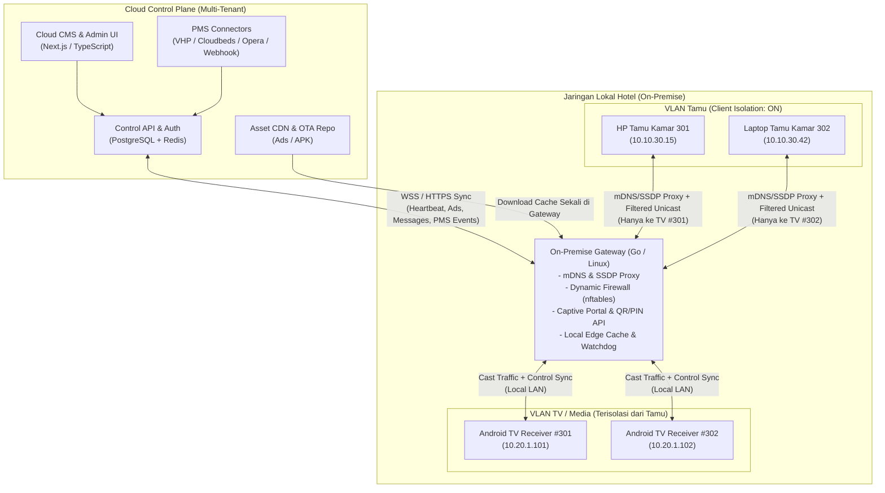
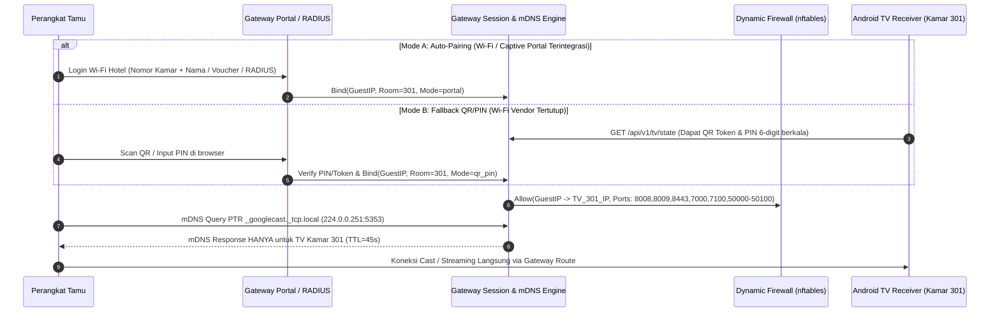

# Arsitektur Teknis — Inaply Cast (Inaply Platform)

Dokumen ini menjelaskan arsitektur jaringan, alur data *pairing*, isolasi antar-kamar, desain *On-Premise Gateway*, *Cloud Multi-Tenant CMS*, dan *Android TV Receiver*.

---

## 1. Topologi Jaringan & Komponen Sistem

### Prinsip Desain Kunci
1. **Pemisahan VLAN Media & Tamu:** Seluruh perangkat TV/Receiver berada di subnet/VLAN khusus (mis. `VLAN 20: 10.20.0.0/16`), sedangkan tamu berada di Guest Wi-Fi (`VLAN 10: 10.10.0.0/16`) dengan *Client Isolation* tetap aktif.
2. **Gateway sebagai Jembatan Terkendali:** Tamu **tidak pernah** dapat berkomunikasi langsung secara L2 dengan subnet TV ataupun antar-tamu. Seluruh penemuan (*discovery*) dan rute L3 menuju TV kamar melewati aturan dinamis di **On-Premise Gateway** (atau diizinkan spesifik per pasangan `Guest IP <-> Room Receiver IP`).
3. **Edge Cache Resilient:** Gateway menyimpan salinan lokal aset iklan, konfigurasi *Welcome Screen*, dan tabel sesi kamar di disk, sehingga operasi di kamar tidak bergantung terus-menerus pada koneksi cloud.

---

## 2. Alur Hybrid Pairing (Auto-Pairing & QR/PIN Fallback)

Kedua mode bermuara pada **satu tabel sesi kamar** (`RoomSession`) di dalam Gateway:

### Detail Penanganan Edge Case Jaringan
* **MAC Randomization:** Pengikatan aktif di *data plane* menggunakan `GuestIP` yang aktif pada saat pairing/autentikasi (dikombinasikan dengan lease DHCP/keepalive portal dan *session token* di browser portal). Jika IP tamu berubah karena *re-DHCP*, RADIUS Accounting / DHCP hook / captive probe memperbarui `GuestIP` tanpa memaksa pairing ulang.
* **Timeout & Checkout:** Saat resepsionis/PMS memicu `POST /api/v1/pms/checkout` untuk kamar `301` (atau saat `expires_at` tercapai):
  1. Seluruh entri `GuestSession` untuk `room_301` dihapus dari memori & edge storage Gateway.
  2. Aturan firewall `GuestIP -> TV_301_IP` segera dicabut (*flush* koneksi aktif bila memakai `conntrack`).
  3. Gateway mengirim perintah *reset session* ke Receiver Kamar 301 agar menghentikan *playback* aktif, membersihkan *cache* cast sementara, dan kembali ke *Welcome Screen*.
  4. Karena TTL mDNS dijaga pendek (30–60 detik), daftar TV pada HP tamu juga otomatis menghilang.

---

## 3. Desain On-Premise Gateway (`services/gateway`)

Dibangun dengan **Go** sebagai *single static binary* agar mudah di-deploy di Mini PC Linux (Debian/Ubuntu/Alpine x86_64 atau ARM64) maupun VM.

### Modul Internal
1. **`internal/mdns` (Wire Codec & Room-Scoped Proxy):**
   * Parser & encoder paket DNS/mDNS (RFC 1035 / RFC 6762 / RFC 6763) murni Go tanpa ketergantungan C/cgo.
   * Mendukung record `PTR`, `SRV`, `TXT`, `A`, `AAAA` serta dekompresi pointer DNS (`0xC0`).
   * Saat menerima *query* layanan Cast (`_googlecast._tcp.local.`, `_airplay._tcp.local.`, `_raop._tcp.local.`, atau `.local.` hostname receiver), proxy memeriksa `srcIP` di `SessionStore`.
   * Hanya mengembalikan jawaban milik receiver yang terdaftar di kamar tamu tersebut dengan TTL pendek (45 detik).
2. **`internal/ssdp` (Room-Scoped DIAL Discovery):**
   * Mendengarkan multicast `239.255.255.250:1900` untuk `M-SEARCH` (`ssdp:all` / `urn:dial-multiscreen-org:service:dial:1`) dan membalas hanya dengan `LOCATION` XML milik receiver kamar yang terotorisasi.
3. **`internal/session` (Registry, Pairing, & Lifecycle):**
   * Menyimpan struktur `Room`, `ReceiverDevice`, `GuestSession`, `PinChallenge`, `WelcomeConfig`, `AdCampaign`, dan `GuestMessage`.
   * Menghasilkan PIN 6-digit / token QR bertanda waktu (*expiring*) per kamar dan melakukan rotasi otomatis.
   * Menyediakan *janitor loop* untuk membersihkan sesi & PIN kedaluwarsa secara berkala.
4. **`internal/firewall` (Dynamic Rule Engine):**
   * Abstraksi `FirewallDriver`:
     * `NftablesDriver`: mengelola *set/chain* `nftables` secara deterministik (`inet inaply forward`) sehingga hanya pasangan `(guest_ip, receiver_ip)` terotorisasi yang lolos pada port layanan Cast/AirPlay/DIAL.
     * `MemoryDriver`: implementasi *in-memory* untuk pengujian unit, *dry-run*, dan lingkungan non-root.
5. **`internal/edge` (Atomic Persistence & Cloud Sync):**
   * Menyimpan *state* lokal ke file JSON atomik (`write temp + rename`) sehingga reboot/power outage di hotel tidak menghapus daftar kamar, iklan yang sudah ter-cache, maupun sesi tamu aktif.
   * Menyediakan antarmuka *Cloud Sync Client* (heartbeat, pull config/ads, push telemetry/metrics).
6. **`internal/api` (HTTP Server):**
   * Captive Portal (`/portal`, `/api/v1/pair/portal`)
   * Fallback QR/PIN (`/pair`, `/api/v1/pair/pin`)
   * TV Receiver API (`/api/v1/tv/state`, `/api/v1/tv/heartbeat`)
   * Front Office & PMS Webhook (`/fo`, `/api/v1/pms/checkin`, `/api/v1/pms/checkout`, `/api/v1/ads`, `/api/v1/messages`)

---

## 4. Desain Android TV Receiver (`apps/tv-receiver`)

* **Bahasa & Platform:** Kotlin native, Android TV (API 29+ / Android 10–14), Leanback UI / Jetpack Compose for TV.
* **Lockdown (Device Owner Mode):**
  * Di-provision saat staging menggunakan QR provisioning / `dpm set-device-owner`.
  * Menggunakan `LockTask` / Custom Home Launcher agar tombol Home dan Back tidak keluar ke launcher standar atau Settings.
  * Mengunci instalasi aplikasi asing dan mencegah *factory reset* dari menu UI oleh tamu.
* **Lapisan Casting & Mirroring:**
  * **Google Cast:** Menggunakan kapabilitas Cast Receiver bawaan perangkat Google TV/Android TV bersertifikat (Widevine L1 + Google Cast resmi) sehingga Netflix, YouTube, Spotify, dan Disney+ berjalan normal.
  * **AirPlay / WebRTC Mirroring:** Layanan latar belakang ringan untuk menerima *mirroring* layar iOS/macOS non-DRM saat tamu ingin menampilkan foto/presentasi.
* **Lapisan Backdrop & HDMI-CEC:**
  * Saat tidak ada sesi *cast* aktif (`idle`), launcher menampilkan **Welcome Screen** + rotasi **TV Ads** dari media yang sudah di-cache di penyimpanan lokal (download melalui Gateway agar hemat internet).
  * `HdmiControlManager` / `TvInputManager` memicu *CEC One-Touch Play / Active Source* ketika sesi cast dimulai atau pesan darurat masuk.
  * Polling/SSE/WebSocket lokal ke Gateway (`http://gateway.local/api/v1/tv/state`) untuk update pesan tamu (*pop-up overlay*), status pairing, dan perintah `force_reset` saat *check-out*.

---

## 5. Desain Cloud Multi-Tenant CMS (`apps/cms`)

* **Stack:** TypeScript, Next.js (App Router), PostgreSQL, Redis, S3/R2 Object Storage (aset video/gambar promo).
* **Model Multi-Tenancy:**
  * `partners` (ISP/SI atau grup manajemen) -> `properties` (hotel) -> `gateways` -> `rooms` -> `receivers`.
  * Pembatasan akses berbasis peran (*RBAC*): `super_admin`, `partner_admin`, `hotel_gm`, `hotel_marketing`, `hotel_fo`, `noc_support`.
* **Sinkronisasi Cloud <-> Edge Gateway:**
  * Gateway membuka koneksi keluar (*outbound*) ke Cloud melalui HTTPS + WebSocket/MQTT (tidak memerlukan *port forwarding* atau IP publik statis di hotel!).
  * Aset promo (gambar/video TV Ads) diunduh oleh Gateway ke cache lokalnya, lalu TV Receiver mengambil aset tersebut langsung dari Gateway LAN.

---

## 6. Model Ancaman & Keamanan (*Threat Model*)

| Ancaman | Mitigasi |
|---|---|
| Tamu kamar A mencoba *cast* atau *port scan* ke TV kamar B | Isolasi L2 VLAN + *mDNS/SSDP proxy* hanya mengembalikan IP TV kamar sendiri + aturan `nftables` hanya membuka port spesifik ke IP TV kamar terpairing |
| Tamu membawa pulang dongle atau melakukan *factory reset* | Enclosure fisik terkunci ke braket TV + Android *Device Owner* menonaktifkan menu Settings/Reset/ADB untuk pengguna |
| Kredensial Netflix/Spotify tamu tertinggal di TV | Tamu login di ponsel sendiri; saat *check-out* Gateway memutus sesi & TV Receiver menjalankan *reset state* |
| Penyerang memalsukan paket mDNS di Wi-Fi tamu | *Client isolation* memblokir trafik antar-tamu; hanya Gateway yang menerima/menjawab mDNS; rule `ebtables`/`bridge` mencegah *rogue responder* |
| Koneksi internet hotel terputus | Gateway memiliki *Edge Cache* lokal untuk seluruh sesi, Welcome Screen, dan media TV Ads |
